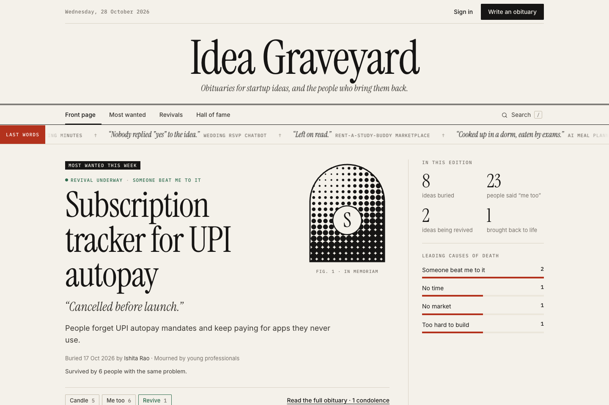
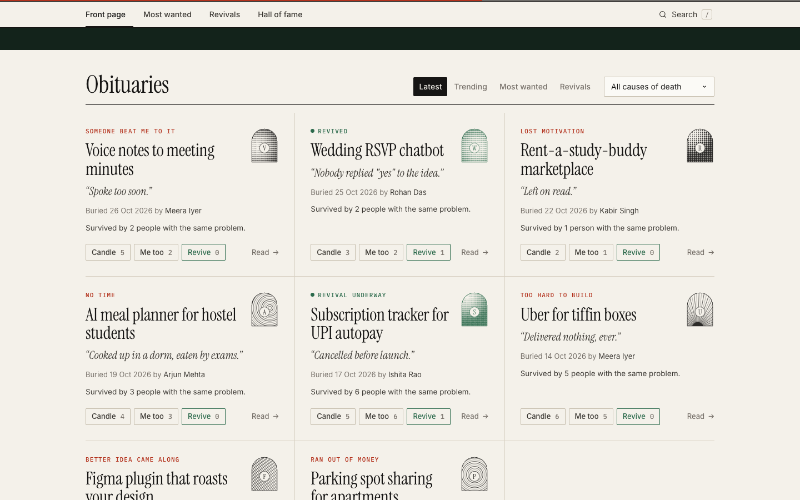
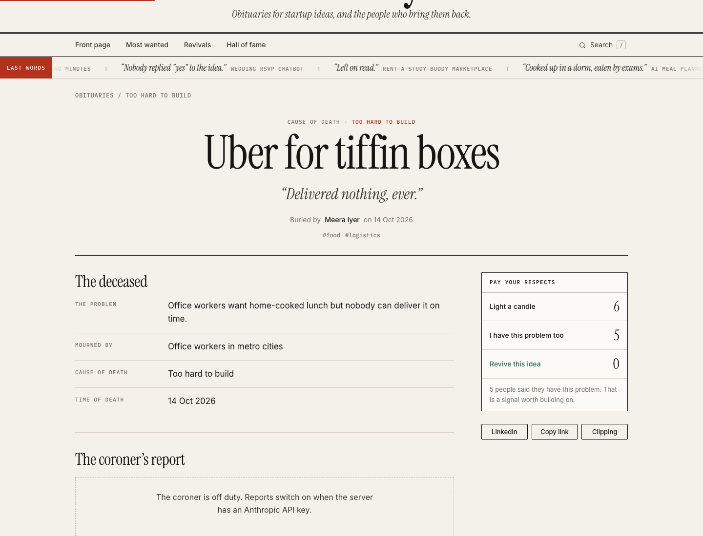
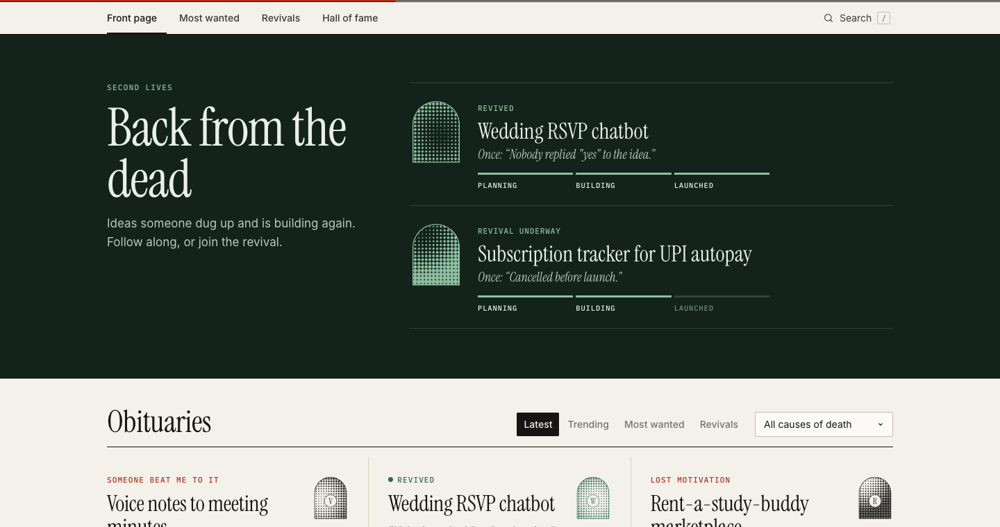
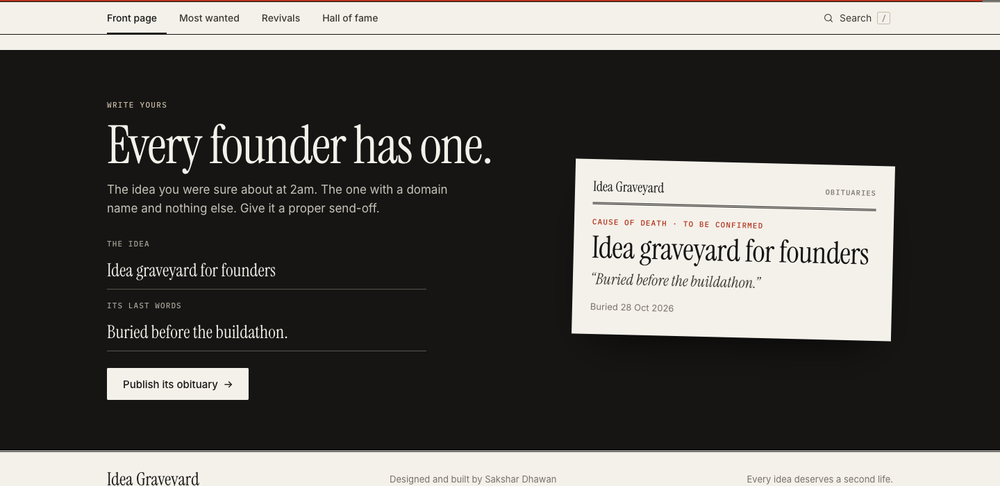
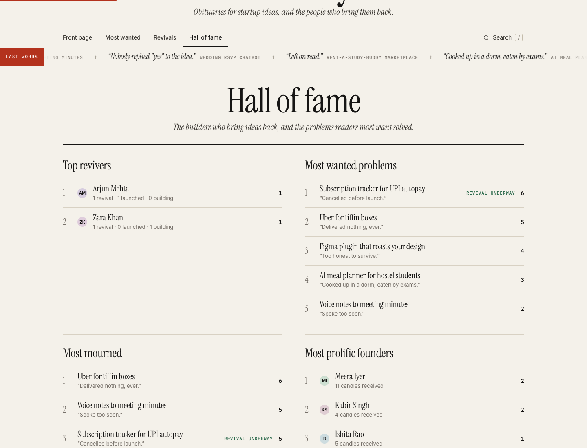
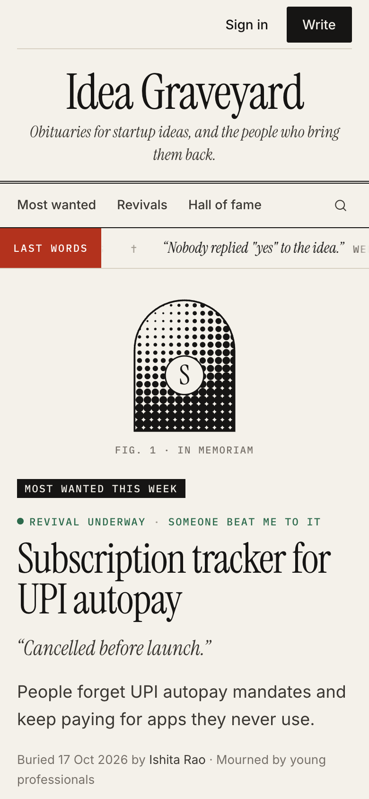

<div align="center">

# Idea Graveyard

**Obituaries for startup ideas, and the people who bring them back.**

Every founder has ideas dying in a notes app. Bury yours with an epitaph, let others say *"I have this problem too"*, and watch builders revive it.

**[Live site: idea-graveyard-uoen.onrender.com](https://idea-graveyard-uoen.onrender.com)** · [Run it locally](#run-it-locally) · [How it works](#how-it-works) · [API](#api)

[](https://github.com/sakshar2303/idea-graveyard/actions/workflows/ci.yml)
[](https://render.com/deploy?repo=https://github.com/sakshar2303/idea-graveyard)



</div>

## Why

Most founders don't fail because they can't build. They fail because they build something nobody wants, and the ideas that *were* wanted get abandoned in a notes app.

Idea Graveyard turns those dead ideas into a public pool of problems people have already felt. Every "me too" is a validation signal, so the next builder can see which problems are worth reviving before they write a line of code.

## How it works

1. **Bury it.** Write the idea's obituary: the problem it solved, who had it, how it died and its last words.
2. **Let people feel it.** Readers light a candle or tap **Me too**, which counts as real validation for the problem.
3. **Raise it.** A builder revives the idea, posts progress through *Planning → Building → Launched*, and the obituary turns green.

## Tour

<table>
  <tr>
    <td width="50%"><br><sub><b>The obituaries.</b> Ruled newspaper columns. Every idea gets its own generative ink engraving.</sub></td>
    <td width="50%"><br><sub><b>An obituary.</b> The deceased, the coroner's report (AI), revival efforts and condolences.</sub></td>
  </tr>
  <tr>
    <td width="50%"><br><sub><b>Second lives.</b> Revived ideas and how far each one has got.</sub></td>
    <td width="50%"><br><sub><b>Write yours.</b> Type a dead idea and watch its obituary set as you type.</sub></td>
  </tr>
  <tr>
    <td width="50%"><br><sub><b>Hall of fame.</b> Top revivers, most wanted problems and the leading causes of death.</sub></td>
    <td width="50%" align="center"><br><sub><b>On a phone.</b> Fully responsive.</sub></td>
  </tr>
</table>

## Features

**Founders**
- A three-step obituary editor with a live press-clipping preview and autosaved drafts
- Share to LinkedIn, copy a caption, or download a 1080×1350 newspaper clipping of the obituary
- Link previews (LinkedIn, WhatsApp) show the idea's name and epitaph

**Readers**
- Light a candle, say **Me too**, and leave condolences on any obituary
- Notifications when someone revives your idea, shares your problem, leaves a condolence or launches it
- A live wire of the latest last words, plus real-time alerts for new obituaries and revivals

**Builders**
- Revive an idea with a plan and a project link, then post progress updates to a public timeline
- **The coroner's report:** Claude explains why the idea really died, gives its odds in a second life, a revival plan, a 48-hour MVP and the questions to ask real users first

**Discovery**
- Sort by latest, trending, most wanted or revivals, and filter by cause of death or tag
- Search everything with `/` or `⌘K`
- Hall of fame leaderboards and a leading-causes-of-death chart

**Accounts and moderation**
- Username and password accounts, profiles with bios and stats
- Reporting plus a moderation queue for admins (hide, restore, dismiss)

## Design

An editorial newspaper system rather than a dashboard: newsprint paper, black ink, one red for deaths and one green for revivals. Headlines are set in Instrument Serif, body text in Inter, labels in IBM Plex Mono, all on a ruled column grid. Each idea's engraving (halftone, rings, etching or sunburst) is generated from its id, so the same idea always gets the same plate. Motion is quiet: content fades up as you scroll, headlines underline as they draw in, and lit candles flicker. Reduced-motion settings are respected.

## Stack

| Layer | Choice |
| --- | --- |
| Server | Node.js 22.13+ with no web framework |
| Database | SQLite through the built-in `node:sqlite` (WAL mode) |
| Frontend | Vanilla ES modules and hand-written CSS, no build step |
| AI | Claude Opus 5.5 through the Anthropic SDK, with schema-validated JSON output |
| Ops | Dockerfile, Render blueprint, GitHub Actions CI |

```
server.js          HTTP server, routes, security headers, live events
lib/db.js          SQLite schema and demo data
lib/auth.js        password hashing and sessions
lib/autopsy.js     the coroner's report via Claude
public/index.html  app shell and masthead
public/css/        editorial design system
public/js/         router, views, dialogs, engravings and motion
test/              API test suite (node:test)
```

## Run it locally

Requires Node.js 22.13 or later.

```bash
git clone https://github.com/sakshar2303/idea-graveyard.git
cd idea-graveyard
npm install
npm run dev
```

Open http://localhost:3000. The first run creates `data/graveyard.db` with demo obituaries. The demo founders cannot sign in, so create your own account. Sign up as `sakshar`, or any name listed in `ADMIN_USERNAMES`, to get moderation access.

To turn on the coroner's report, add an Anthropic API key:

```bash
ANTHROPIC_API_KEY=sk-ant-... npm run dev
```

Run the tests:

```bash
npm test
```

## Deploy

Live at **[https://idea-graveyard-uoen.onrender.com](https://idea-graveyard-uoen.onrender.com)**. To deploy your own copy, click **Deploy to Render** above and sign in with GitHub. The included `render.yaml` sets everything up. Paste an `ANTHROPIC_API_KEY` when asked if you want the coroner's report, or leave it blank.

The free plan sleeps after 15 minutes without visitors (the first visit after that takes about 30 seconds) and has no persistent disk, so posts reset whenever it restarts. For a permanent site, switch `plan` to `starter` in `render.yaml` and uncomment the `disk` block.

## Configuration

See [.env.example](.env.example).

| Variable | Default | Purpose |
| --- | --- | --- |
| `PORT` | `3000` | Port to listen on |
| `DATA_DIR` | `./data` | Folder for the SQLite database; use a persistent disk in production |
| `ADMIN_USERNAMES` | unset | Comma-separated usernames with moderation access |
| `ANTHROPIC_API_KEY` | unset | Turns on the coroner's report |
| `SEED` | `1` | Set to `0` to start with no demo obituaries |
| `TRUST_PROXY` | unset | Set to `1` behind a reverse proxy so rate limits see real client IPs |
| `COOKIE_SECURE` | auto | Secure cookies; on automatically when `NODE_ENV=production` |

## API

All write requests need `Content-Type: application/json`. Routes marked 🔒 need a session.

| Method | Path | Notes |
| --- | --- | --- |
| `GET` | `/api/me` | Current user, causes of death, whether AI is on |
| `POST` | `/api/auth/signup` · `/login` · `/logout` | Accounts |
| `PATCH` | `/api/me` 🔒 | Display name and bio |
| `GET` | `/api/ideas` | `sort`, `status`, `cause`, `tag`, `q`, `user`, `offset` |
| `POST` | `/api/ideas` 🔒 | Publish an obituary |
| `GET` / `DELETE` | `/api/ideas/:id` | Full obituary; delete (founder or admin) |
| `POST` | `/api/ideas/:id/candle` · `/same` 🔒 | Toggle a candle or a "me too" |
| `POST` | `/api/ideas/:id/resurrect` 🔒 | Start a revival: `{pitch, link}` |
| `PATCH` / `DELETE` | `/api/resurrections/:id` 🔒 | Post progress `{status, note, link}`, or abandon |
| `POST` | `/api/ideas/:id/eulogies` 🔒 | Leave a condolence `{body}`; `DELETE /api/eulogies/:id` |
| `POST` | `/api/ideas/:id/autopsy` 🔒 | The coroner's report; runs once per idea, then cached |
| `POST` | `/api/ideas/:id/report` 🔒 | `{reason}` |
| `GET` | `/api/notifications` 🔒 | Plus `POST /api/notifications/read` |
| `GET` | `/api/users/:username` · `/api/leaderboard` · `/api/stats` | Public |
| `GET` | `/api/events` | Server-sent events: `buried`, `resurrected`, `launched` |
| `GET` / `POST` | `/api/admin/reports` · `/api/admin/ideas/:id/{hide,restore,dismiss}` 🔒 | Admins only |

## Security

- Strict Content Security Policy with no inline scripts or styles, plus HSTS, `nosniff` and no framing
- CSRF protection: JSON-only writes and an Origin check, with `SameSite=Lax` HttpOnly session cookies
- scrypt password hashes, constant-time comparisons and equal timing for unknown usernames
- Per-IP and per-user rate limits, body size limits, a honeypot field and caps on AI usage
- User text is only ever rendered as text, never as HTML, and link-preview tags are escaped
- AI input is wrapped as data, and AI output is schema-validated and clamped

## License

MIT · Designed and built by **Sakshar Dhawan**
